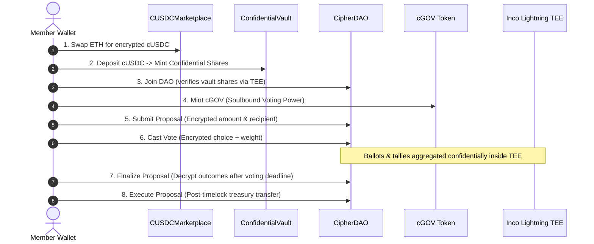

# 🛡️ Cipher DAO

[](https://inco.org)
[](https://sepolia.basescan.org)
[](https://soliditylang.org/)
[](https://nextjs.org/)
[](https://nillion.com)
[](https://x402.org)
[](LICENSE)

> **Next-Generation Confidential Governance System** with encrypted voting, confidential balances, quadratic voting, zero-signature session UX, and an autonomous privacy-preserving AI governance advisor.

---

## 📖 Overview

Traditional on-chain DAOs suffer from severe information leakage: voter balances, ballot choices, running tallies, and proposed treasury payouts are exposed on public ledgers. This transparency causes voter intimidation, bandwagon voting effects, MEV exploitation, and front-running on treasury executions.

**Cipher DAO** solves this crisis by combining **Inco's Trusted Execution Environment (TEE) Lightning technology** with **Nillion's confidential AI (nilAI & nilDB)**. All sensitive governance data—from treasury shares and governance tokens to individual ballots and tally counters—remains homomorphically encrypted and confidential throughout its entire lifecycle.

---

## 🏛️ System Architecture

```
                               ┌────────────────────────────────────────┐
                               │               User Client              │
                               │  (Next.js 16 + Privy + Session Keys)   │
                               └───────┬────────────────────────┬───────┘
                                       │                        │
                      Encrypted Queries│                        │Web3 Transactions
                      & nilAI Prompts │                        │(Inco SDK 0.7.10)
                                       ▼                        ▼
               ┌───────────────────────────────┐     ┌───────────────────────────────────┐
               │    Cipher DAO AI Advisor      │     │         Smart Contracts           │
               │   (Express + nilAI + nilDB)   │     │         (Base Sepolia)            │
               ├───────────────────────────────┤     ├───────────────────────────────────┤
               │ • Private Proposal Evaluation │     │ • CUSDCMarketplace.sol            │
               │ • ERC-8004 Agent Registry     │     │ • ConfidentialVault.sol (ERC-4626)│
               │ • Encrypted Chat History      │     │ • ConfidentialGovernanceToken.sol │
               │ • x402 Micropayments Paywall  │     │ • CipherDAO.sol (Governor)        │
               └───────────────────────────────┘     └─────────────────┬─────────────────┘
                                                                       │
                                                                       ▼
                                                     ┌───────────────────────────────────┐
                                                     │         Inco Lightning TEE        │
                                                     │  • Encrypted euint256 / ebool     │
                                                     │  • Blinded Ballots & Tallies      │
                                                     │  • ACL Cryptographic Attestations │
                                                     └───────────────────────────────────┘
```

---

## 📦 Monorepo Workspace

This repository is organized as a high-performance monorepo:

### 1. Smart Contracts (`apps/inco-lite-template`)
Hardhat-based Solidity suite implementing confidential DAO governance:
- **`CipherDAO.sol`**: Main governance contract supporting encrypted voting, hidden proposal amounts, both standard & quadratic voting mechanisms, quorum calculation, and execution timelocks.
- **`ConfidentialVault.sol`**: ERC-4626-inspired confidential treasury vault with virtual offset ($\delta = 3$) protection against share inflation and donation exploits.
- **`ConfidentialGovernanceToken.sol` (`cGOV`)**: Non-transferable, soulbound governance token minted with ETH, strictly separating governance weight from economic capital.
- **`CUSDCMarketplace.sol`**: Exchange mechanism converting native ETH into encrypted `cUSDC`.

### 2. Frontend Interface (`apps/nextjs-template`)
Cutting-edge, cyberpunk glassmorphic web application built with Next.js 16:
- **Zero-Signature UX**: Implements a client-side session key scheme reducing wallet signing prompts by **93%** during confidential balance viewing.
- **Encrypted Balance Inspection**: Live on-demand decryption using session keys and Inco SDK.
- **Proposal Lifecycle**: Proposal submission, encrypted ballot casting, timelock queueing, and execution.
- **Dual Wallet Connectivity**: Seamless support for injected wallets (MetaMask) and embedded wallets via Privy.

### 3. Confidential AI Advisor (`apps/express-ts`)
Autonomous AI agent integrated into the governance lifecycle:
- **nilAI Private Inference**: Evaluates proposal pros, cons, and governance impact inside a secure enclave without data exposure.
- **nilDB Encrypted Storage**: Stores conversation history confidentially on decentralized secret-vault networks.
- **ERC-8004 Identity**: On-chain verifiable agent registration.
- **x402 Micropayment Protocol**: Monetized query execution via cryptographic payment headers.

---

## 🔒 Key Privacy & Security Highlights

| Feature | Cipher DAO Implementation |
|---|---|
| **Confidential Balances** | Member `cUSDC` balances and `cGOV` voting tokens are stored as encrypted `euint256`. |
| **Encrypted Ballots** | Individual choices (For / Against / Abstain) and voting weights are hidden from both the public and DAO admins. |
| **Hidden Running Tallies** | Interim results are sealed in TEE memory until voting formally concludes, eliminating herd behavior. |
| **MEV Protection** | Requested treasury payout amounts remain encrypted during active voting to prevent predatory arbitrage. |
| **Inflation Attack Immunity** | Vault employs virtual offset math ($\delta = 3$, $10^3$ virtual shares) to defeat ERC-4626 donation attacks. |
| **Ragequit Mechanism** | Dissatisfied members can exit the vault before proposal execution, automatically burning voting rights. |

---

## 📍 Deployed Contracts (Base Sepolia)

| Contract | Network | Address |
|---|---|---|
| **CipherDAO** | Base Sepolia (`84532`) | [`0x5d22F3621dD106Daf7Ea8EA7C93c8dF29f2Ae1e7`](https://sepolia.basescan.org/address/0x5d22F3621dD106Daf7Ea8EA7C93c8dF29f2Ae1e7) |
| **ConfidentialVault** | Base Sepolia (`84532`) | [`0xb0C98C67150Ec4594E8b9F234A04468cCfC0dD82`](https://sepolia.basescan.org/address/0xb0C98C67150Ec4594E8b9F234A04468cCfC0dD82) |
| **ConfidentialGovernanceToken (cGOV)** | Base Sepolia (`84532`) | [`0xdA9B7d018e06f4CE070e708653da7629781A101b`](https://sepolia.basescan.org/address/0xdA9B7d018e06f4CE070e708653da7629781A101b) |
| **CUSDCMarketplace** | Base Sepolia (`84532`) | [`0x637076397294eC96A92415Be58ca3e24fE44d529`](https://sepolia.basescan.org/address/0x637076397294eC96A92415Be58ca3e24fE44d529) |

---

## 🔄 End-to-End User Journey



---

## 🚀 Quick Start

### Prerequisites
- [Node.js](https://nodejs.org/) (>= 18.0.0)
- [npm](https://www.npmjs.com/) or [pnpm](https://pnpm.io/)

### Installation
```bash
# Clone the repository
git clone https://github.com/dhanushh00/Cipher-DAO.git
cd Cipher-DAO

# Install workspace dependencies
npm install
```

### Local Development

#### 1. Run Web Application
```bash
cd apps/nextjs-template
npm run dev
# Open http://localhost:3000 in your browser
```

#### 2. Run Contracts & Tests
```bash
cd apps/inco-lite-template
npm test
```

#### 3. Run AI Backend Agent
```bash
cd apps/express-ts
npm run dev
```

---

## 📚 Detailed Documentation

- [Smart Contracts Architecture & Guide](apps/inco-lite-template/README.md)
- [Frontend & Inco SDK Integration](apps/nextjs-template/README.md)
- [AI Governance Advisor & nilAI Setup](apps/express-ts/README.md)

---

## 📄 License

This project is licensed under the [MIT License](LICENSE).
